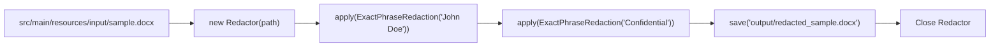

# Search and Redact Keywords and Phrases with GroupDocs Redaction for Java

This repository demonstrates how to search and redact specific keywords or phrases globally across multiple document formats using GroupDocs Redaction for Java.

## How it works

This example shows how to load a document, apply multiple exact-phrase redactions (e.g., for names or sensitive terms), and save the sanitized output. The workflow follows GroupDocs Redaction’s standard pipeline: initialize `Redactor`, apply `ExactPhraseRedaction`, and save the result.



**Important:** Ensure input files exist under `src/main/resources/input/` before running. Evaluation mode applies watermarks and limits redaction scope.

## Topics covered

Search and redact specific keywords or phrases globally across multiple document formats.

## Prerequisites

- Java 8 or higher
- Maven 3.x

## License

GroupDocs Redaction for Java requires a license for production use. To obtain a free temporary license, visit: [https://purchase.groupdocs.com/temporary-license](https://purchase.groupdocs.com/temporary-license)

## Setup & Run

1. Clone the repository.
2. Place a sample document (e.g., `sample.docx`) in `src/main/resources/input/`.
3. Run:
   ```bash
   mvn compile exec:java
   ```

Output will be saved to `src/main/resources/output/redacted_sample.docx`.

## FAQ

**Q: Which document formats are supported for keyword redaction?**  
A: GroupDocs Redaction supports PDF, DOCX, XLSX, PPTX, images (JPEG, PNG, etc.), and more. See the [official docs](https://docs.groupdocs.com/redaction/java/) for the full list.

**Q: Is the phrase search case-sensitive?**  
A: By default, `ExactPhraseRedaction` is case-insensitive. You can make it case-sensitive by using the constructor overload with `isCaseSensitive = true`.

**Q: Can I redact multiple phrases in one pass?**  
A: Yes — call `redactor.apply()` multiple times with different `ExactPhraseRedaction` instances, as shown in this example.

For more details, see the official documentation: [https://docs.groupdocs.com/redaction/java/](https://docs.groupdocs.com/redaction/java/)
